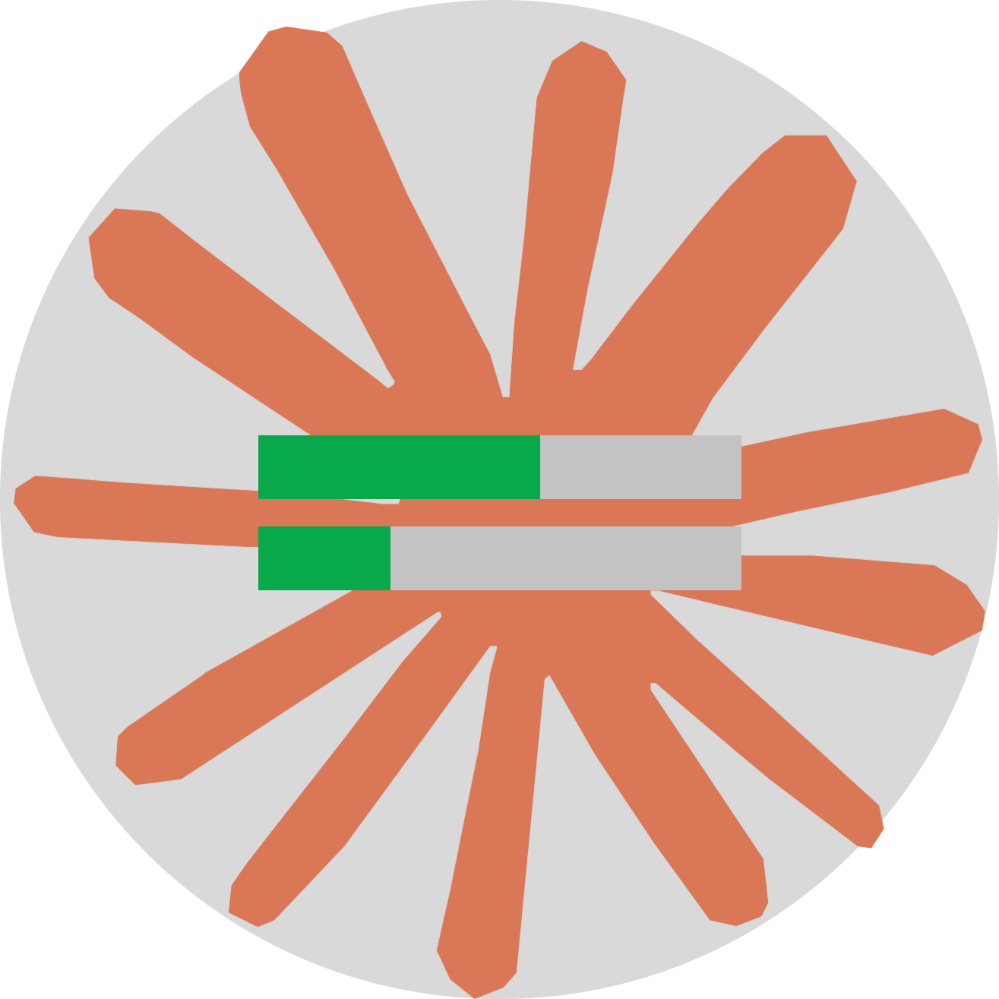

<p align="center"></p>

# Claude Usage Overlay

Overlay para Windows que mostra, sempre por cima dos outros aplicativos, os mesmos dados do comando `/usage` do Claude Code: uso da sessão atual (5h), limites semanais, limites por modelo e créditos extras — com contagem regressiva até cada reset.

## Recursos

- **Sempre no topo**, inclusive sobre apps em tela cheia sem borda
- **Arraste livremente** pela tela — a posição é lembrada
- **Minimizar** para uma barrinha compacta (S = sessão, W = semanal)
- **Atualização automática** (30s a 10 min) e logo após cada reset diário/semanal
- **Pausar** a atualização dos dados de uso
- Barras com cor por nível: verde, amarelo (≥70%) e vermelho (≥90%)
- **Avisos do Claude Code**: mostra quando o Claude faz uma pergunta, pede permissão ou termina a tarefa (veja abaixo)
- Ícone na bandeja: mostrar/ocultar, atualizar, pausar, intervalo, iniciar com o Windows, avisos, sair

## Requisitos

- Windows 10/11
- [Node.js](https://nodejs.org/) 18+
- [Claude Code](https://claude.com/claude-code) com login feito (o overlay lê `~/.claude/.credentials.json`)

## Instalação

```bash
git clone https://github.com/ArlanVOID/Claude-Usage-Overlay.git
cd Claude-Usage-Overlay
npm install
npm run shortcut   # cria o atalho "Claude Usage Overlay" com o ícone
```

## Uso

- Dê dois cliques em **Claude Usage Overlay** (atalho) ou em `Iniciar Overlay.vbs`
- Ou rode `npm start`

Se o login expirar, o overlay avisa — basta abrir o Claude Code para renovar.

## Avisos do Claude Code

O overlay pode avisar, de forma discreta, quando uma sessão do Claude Code para e fica esperando por você:

| Estado | Quando |
| --- | --- |
| **Pergunta** (laranja, pulsando) | o Claude usou o `AskUserQuestion` ou terminou a resposta com uma pergunta |
| **Permissão** (laranja, pulsando) | o Claude está esperando você aprovar uma ferramenta |
| **Concluído** (verde) | o Claude terminou a tarefa |
| Trabalhando (cinza) | a sessão está em andamento |

- Cada sessão aparece pelo nome da pasta do projeto, com o tempo desde o último evento; passe o mouse para ver a mensagem
- Clique em uma sessão para dispensar o aviso; ele também some sozinho quando você responde ao Claude
- A borda do overlay pisca rapidamente quando chega um aviso novo, e o ícone da bandeja ganha um ponto verde
- Minimizado, um pontinho à esquerda das barras indica sessões aguardando (clique para expandir)
- Na bandeja: **Avisos do Claude Code** liga/desliga os avisos e **Som nos avisos** toca um toque curto e discreto (ligado por padrão)

Para ativar, instale os hooks no Claude Code (uma vez só):

```bash
npm run hooks          # ou, na bandeja: "Hooks instalados no Claude Code"
npm run hooks:remove   # para remover
```

Isso adiciona ao `~/.claude/settings.json` (com backup em `settings.json.overlay-backup`) os hooks `UserPromptSubmit`, `Stop`, `Notification`, `SessionEnd` e `PreToolUse`/`PostToolUse` do `AskUserQuestion`, todos chamando `scripts/overlay-hook.js`. Seus outros hooks e configurações não são alterados. Reinicie as sessões do Claude Code já abertas depois de instalar. Se você mover a pasta do overlay, instale os hooks de novo.

O hook só grava um pequeno arquivo por sessão em `~/.claude/overlay-sessions/`, que o overlay observa — nada sai do seu computador.

## Como funciona

O overlay consulta o mesmo endpoint que o `/usage` usa (`api.anthropic.com/api/oauth/usage`), autenticado com o token OAuth do Claude Code. O token nunca é renovado ou alterado pelo overlay, e nenhum dado é enviado para outro lugar.
